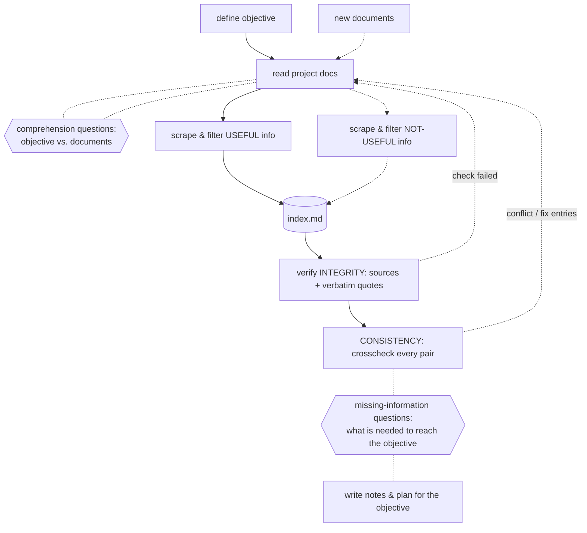

# doc-workflow

A [DeepSeek Harness](https://github.com/deepseek-ai) plugin bundle that turns "read the project docs and make a plan" into an enforced, auditable workflow: **objective → document reading → verified index → clarification gates → notes & plan**.

The agent cannot silently hand you conclusions scraped from documents. Every claim it keeps in the index is anchored to a verbatim quote from a real file, programmatically re-checked, and judged for trustworthiness — and whenever the documents are unclear or insufficient *for your objective*, the workflow stops and asks **you** questions.

## The workflow



- **Comprehension gate** (red line 1): before extracting anything, the agent must ask you what is ambiguous about the objective *given these documents*, and you must answer.
- **Two scrapes**: useful entries (`U1…`) and explicitly rejected ones (`N1…`) both land in `index.md`, so the filtering is reviewable, not invisible.
- **Source-backed only (v2)**: every entry carries a written source — either an internal doc (`source_file` + **mandatory verbatim `source_quote`**) or an external one (`source_ref` URL/path + quote). Content without a quote is rejected at admission: nothing is ever *assumed*.
- **Integrity** (the green→blue loop): `docflow verify` checks programmatically that each entry's anchor file still exists and its verbatim quote is still found in it (whitespace-normalized), and that every entry was attested (`ok`/`suspect`). A line anchor without its quote now *fails* — it cannot prove the content. External sources (URL or foreign path) additionally block `VERIFIED` until a human vouches: `attest verdict=trusted` after you reviewed them.
- **Logical consistency (v2)**: after integrity passes, `docflow crosscheck` walks the **pair matrix** over all useful entries: each pair is judged `consistent` or `conflict` (conflicts record a note; `consistency.md` lists the matrix with mechanical value-hints — dates/versions/quantities that differ between the two entries). Any edit to an entry invalidates its pairs. The gaps gate and the plan open only when integrity **and** consistency are `VERIFIED`.
- **Gaps gate** (red line 2): only after verification passes can the agent ask you what information is still missing to reach the objective.
- **New documents** can be ingested at any time (`docflow ingest`); the understanding gate re-arms for confirmation and verification becomes stale.

## What you get

| Piece | What it does |
|---|---|
| `docflow` host tool | The whole state machine, one tool with an `action` parameter: `status · start · gate_ask · gate_answer · add_entries · update_entry · remove_entry · attest · verify · crosscheck · ingest · write_plan · reset`. Every result carries a `next[]` list of the exact next steps; a system-prompt section keeps the agent driving the workflow literally. |
| State on disk | `<cwd>/.doc-workflow/` — `state.json`, `objective.md`, `index.md`, `questions-understanding.md`, `questions-gaps.md`, `verification.md`, `consistency.md`, `NOTES.md`, `PLAN.md`. Plain files: greppable, diffable, survives sessions. |
| Right-sidebar panel | A live read-only dashboard (tab **Document workflow**): stage rail with the v2 *consistency* phase, a VERIFIED/pending/conflict banner, integrity pills + the consistency matrix (missing pairs, conflict notes), expandable U/N entries with source badge (internal / external `ext`), verify/attest dots and the verbatim quote, pending new documents, plan block. Auto-refreshes every 7 s, discovers one panel per project in the workspace. |

## Install

In a DeepSeek Harness session, install the bundle directory:

```
plugin_manager install_bundle <path-to>/doc-workflow-plugin
```

Or add to your profile pack the patch row:

```yaml
- insert:
    - id: doc-workflow
      name: '@local/doc-workflow'
```

## Use

Kick off with an objective and document roots:

> start a docflow for "migrate the billing API from v1 to v2", docs in `./docs`

The agent will run `docflow start`, ask its comprehension questions (via `ask_user_question` in chat), record your answers, extract entries, attest and verify them, ask the gaps questions, and finally write `NOTES.md` + `PLAN.md`. State is enforced server-side: extraction before the comprehension gate is answered is rejected, `write_plan` is rejected until the gaps gate is resolved, etc.

## Development

```bash
node --check index.js && node --check client.js   # host + client halves must parse
cd test && node e2e.mjs                          # 18-assertion regression suite, exits 0
```

The e2e suite drives the real host module through the full happy path plus the failure loop (bogus quote → verify fails → `recheck` → fix → passes → gaps → plan → done) with guardrail checks at every stage-gate.

After editing the host half in a live profile, toggle the plugin (e.g. `include:doc-workflow` off/on) to hot-reload; after editing the client half, reinstall (`remove_bundle` + `install_bundle`) so the client manifest is re-synced.

## Layout

```
index.js              host half: the docflow tool + state machine + system-prompt section
client.js             browser half: right-sidebar live panel (React via harness module loader, tokens-only theming)
cordis.patch.yml      bundle patch row
locale/{en,it}.json   bundle meta
icon.svg              tab/plugin icon
test/e2e.mjs          headless regression suite (+ test/docs fixtures)
```

MIT © b-iurea
