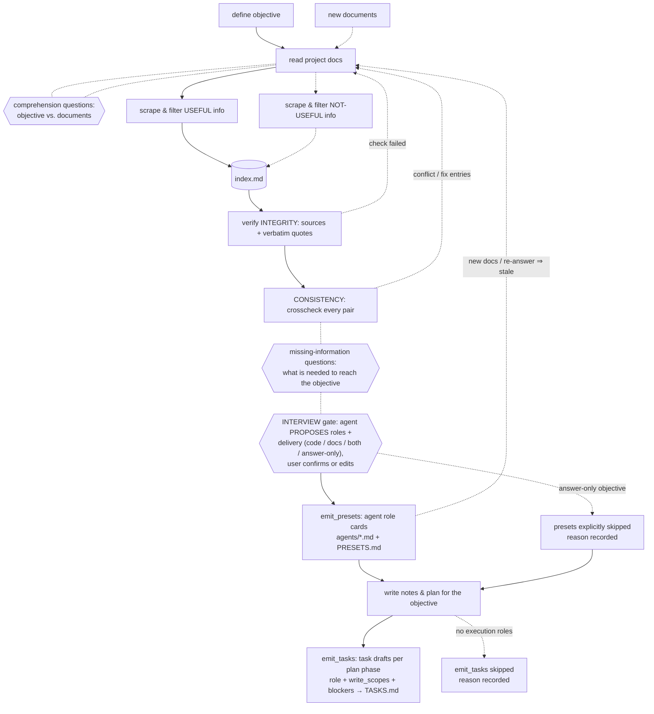

# doc-workflow

A [DeepSeek Harness](https://github.com/deepseek-ai) plugin bundle that turns "read the project docs and make a plan" into an enforced, auditable workflow: **objective → document reading → verified index → clarification gates → interview (agent roles + delivery) → source-backed role cards → notes & plan**.

The agent cannot silently hand you conclusions scraped from documents. Every claim it keeps in the index is anchored to a verbatim quote from a real file, programmatically re-checked, and judged for trustworthiness — and whenever the documents are unclear or insufficient *for your objective*, the workflow stops and asks **you** questions. Before a plan is written, the workflow also interviews you about *who executes it and what gets delivered*, and materializes those roles as portable agent role cards.

## The workflow



- **Comprehension gate** (red line 1): before extracting anything, the agent must ask you what is ambiguous about the objective *given these documents*, and you must answer.
- **Two scrapes**: useful entries (`U1…`) and explicitly rejected ones (`N1…`) both land in `index.md`, so the filtering is reviewable, not invisible.
- **Source-backed only (v2)**: every entry carries a written source — either an internal doc (`source_file` + **mandatory verbatim `source_quote`**) or an external one (`source_ref` URL/path + quote). Content without a quote is rejected at admission: nothing is ever *assumed*.
- **Integrity** (the green→blue loop): `docflow verify` checks programmatically that each entry's anchor file still exists and its verbatim quote is still found in it (whitespace-normalized), and that every entry was attested (`ok`/`suspect`). A line anchor without its quote now *fails* — it cannot prove the content. External sources (URL or foreign path) additionally block `VERIFIED` until a human vouches: `attest verdict=trusted` after you reviewed them.
- **Logical consistency (v2)**: after integrity passes, `docflow crosscheck` walks the **pair matrix** over all useful entries: each pair is judged `consistent` or `conflict` (conflicts record a note; `consistency.md` lists the matrix with mechanical value-hints — dates/versions/quantities that differ between the two entries). Any edit to an entry invalidates its pairs. The gaps gate and everything downstream open only when integrity **and** consistency are `VERIFIED`.
- **Gaps gate** (red line 2): only after verification passes can the agent ask you what information is still missing to reach the objective.
- **Interview gate (v3)**: with the index verified and the gaps answered, the agent **proposes** — derived from the verified index, not invented — which agent roles are needed to execute the objective and which delivery applies: `code`, `docs`, both, or `answer-only` for pure-analysis objectives. You confirm or edit (the interview is a confirmation, not an interrogation); answers are logged to `questions-interview.md` and kept as workflow state.
- **Agent role cards (v3)**: `docflow emit_presets` materializes each confirmed role as a portable markdown card under `.doc-workflow/agents/`, indexed by `PRESETS.md`. A card is admitted only when its *reason to exist* cites useful index entries (`source_entries`) — the "why" stays source-backed, the role prompt body is free. Overlapping `write_scope` between cards surfaces as an advisory warning. For `answer-only` objectives presets are explicitly **skipped with a recorded reason** — no bureaucratic roles. `write_plan` unlocks only after cards are emitted or explicitly skipped, and when cards exist the generated *Delivery & team* section is appended to `PLAN.md`.
- **Task drafts (v3.1)**: with the plan written and role cards emitted, `docflow emit_tasks` bridges docs-to-team: each draft names an **emitted** role, sits in a plan phase, inherits the card's `write_scope` and wires `blocked_by` into an acyclic within-batch graph. Validation is enforced (unknown roles, cycles, empty fields are rejected; unreferenced plan phases only warn). Output is `TASKS.md` + a machine-readable `tasks` block in `state.json` — a 1:1 feed for any task board (e.g. harness shared tasks), spawn stays out of the plugin. Explicit skip with reason for objectives that need no execution tasks; stale role cards mark the drafts stale too.
- **New documents** can be ingested at any time (`docflow ingest`); the understanding gate re-arms for confirmation, verification becomes stale, the interview gate re-arms and emitted role cards are marked `stale` (task drafts with them).

## What you get

| Piece | What it does |
|---|---|
| `docflow` host tool | The whole state machine, one tool with an `action` parameter: `status · start · gate_ask · gate_answer · add_entries · update_entry · remove_entry · attest · verify · crosscheck · emit_presets · emit_tasks · ingest · write_plan · reset`. Every result carries a `next[]` list of the exact next steps; a system-prompt section keeps the agent driving the workflow literally. |
| State on disk | `<cwd>/.doc-workflow/` — `state.json`, `objective.md`, `index.md`, `questions-understanding.md`, `questions-gaps.md`, `questions-interview.md`, `verification.md`, `consistency.md`, `PRESETS.md`, `agents/*.md`, `TASKS.md`, `NOTES.md`, `PLAN.md`. Plain files: greppable, diffable, survives sessions. |
| Right-sidebar panel | A live read-only dashboard (tab **Document workflow**): stage rail with the v2 *consistency*, v3 *interview → role cards* and v3.1 *task drafts* phases, a VERIFIED/pending/conflict banner, integrity pills + the consistency matrix (missing pairs, conflict notes), gates (understanding / gaps / interview), the interview block (delivery chips + proposed/confirmed roles), the role-card block (emitted / skipped / stale + per-card pills), the task-draft block (rows with role pill, blockers, write-scope chips), expandable U/N entries with source badge (internal / external `ext`), verify/attest dots and the verbatim quote, pending new documents and the plan block. Auto-refreshes every 7 s, discovers one panel per project in the workspace. |

## Install

In a DeepSeek Harness session, install the bundle directory:

```
plugin_manager install_bundle <path-to>/doc-workflow-plugin
```

Or add to your profile pack the patch row:

```yaml
- insert:
    - id: doc-workflow
      name: '@local/doc-workflow'
```

## Use

Kick off with an objective and document roots:

> start a docflow for "migrate the billing API from v1 to v2", docs in `./docs`

The agent will run `docflow start`, ask its comprehension questions (via `ask_user_question` in chat), record your answers, extract entries, attest and verify them, cross-check consistency, ask the gaps questions, propose the role/delivery interview for your confirmation, emit the role cards, write `NOTES.md` + `PLAN.md` and finally translate the plan into validated `TASKS.md` drafts. State is enforced server-side: extraction before the comprehension gate is answered is rejected, `emit_presets` is rejected until the interview is answered and the index is verified, `write_plan` is rejected until presets are emitted or explicitly skipped, `emit_tasks` only runs after the plan and only with roles that exist among the emitted cards, etc.

## Development

```bash
npm run check    # host + client + suite must parse
npm test         # regression suite (prints its own assertion count), exits 0
```

The e2e suite drives the real host module through the full happy path plus the failure loops (bogus quote → verify fails → `recheck` → fix → passes → gaps → interview → presets → plan → tasks → done; conflict → fix → re-review; answer-only skip path; un-re-answered interview blocks presets; unknown-role / cyclic `emit_tasks` rejected; v1/v2/v3-legacy state migration) with guardrail checks at every stage-gate. CI runs it on Node 20/22/24 via GitHub Actions (`.github/workflows/ci.yml`).

After editing the host half in a live profile, toggle the plugin (e.g. `include:doc-workflow` off/on) to hot-reload; after editing the client half, reinstall (`remove_bundle` + `install_bundle`) so the client manifest is re-synced.

## Layout

```
index.js              host half: the docflow tool + state machine + system-prompt section
client.js             browser half: right-sidebar live panel (React via harness module loader, tokens-only theming)
cordis.patch.yml      bundle patch row
locale/{en,it}.json   bundle meta
icon.svg              tab/plugin icon
DESIGN-v3.md          implementation contract for the interview/presets (v3) flow
DESIGN-v3.1.md        implementation contract for emit_tasks / task drafts (v3.1)
test/e2e.mjs          headless regression suite (+ test/docs fixtures)
.github/workflows/ci.yml   GitHub Actions: npm run check + npm test on Node 20/22/24
```

MIT © b-iurea
